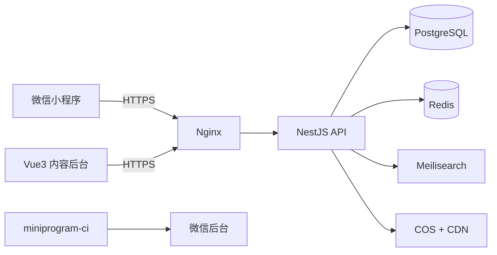

# 《史页》中国历史微信小程序 · 开发大纲

**版本 v0.1（待确认）｜2026-10-18**

> 文档目的：先确认“做什么、做到什么程度、怎么落地”，再进入原型和开发。
>
> 历史类产品真正的成本在内容，不在代码。“每一个大小事件”无法在首版一次做完，建议采用 **“完整框架 + 分级词条 + 持续扩充”** 的方式实现。以下方案按“1 名全栈 + 1 名内容编辑 + 兼职设计/审校、8–10 周首发”假设编写；如果是单人开发，周期和内容量需要相应调整。

---

## 目录

- [0. 一页结论](#0-一页结论)
- [1. 定位与用户](#1-定位与用户)
- [2. 内容范围](#2-内容范围)
- [3. 产品功能](#3-产品功能)
- [4. 数据设计](#4-数据设计)
- [5. 技术方案](#5-技术方案)
- [6. 视觉与体验](#6-视觉与体验)
- [7. 内容生产流程](#7-内容生产流程)
- [8. 项目计划](#8-项目计划)
- [9. 合规与风险](#9-合规与风险)
- [10. 成本与商业化（简）](#10-成本与商业化简)
- [11. 需要你确认](#11-需要你确认)
- [12. 确认后的下一步](#12-确认后的下一步)

---

## 0. 一页结论

| 项目 | 建议 |
|---|---|
| 产品 | 以时间轴为主入口的中国历史知识库：朝代/世纪 → 人物/事件 → 史料出处 |
| 首版范围 | 中国史，史前至 2024-12-31；不含新闻、评论、用户投稿 |
| 首发内容 | 12 个时代、40+ 政权、42 个世纪页、约 300 人物、约 500 事件、30+ 个专题/合集、100 天“今日史事”（3 个月补满 366 天） |
| 核心体验 | 时间轴漫游 + 人物/事件互链 + 全局搜索 + 收藏 + 分享卡片 |
| 技术 | 原生小程序 + TypeScript；NestJS + PostgreSQL；Vue 3 内容后台 |
| 周期 | 8–10 周（小团队）；单人开发建议 12–16 周、内容减半 |
| 最大风险 | 内容准确性与工作量、微信类目/备案、历史地图边界、图片版权 |

> **优先级说明**：P0 = 首发必须；P1 = 上线后 1–3 个月；P2 = 远期。

**建议先确认的 5 件事**：范围（是否含世界史）、首发内容量、技术路线（自建/云开发）、主体与类目、名称与视觉方向。详见第 11 节。

---

## 1. 定位与用户

### 1.1 一句话

“一页一页读历史”：用一个可缩放的中国历史时间轴，把朝代、人物、事件和史料连起来，让普通用户查得到、逛得下去、看得出处。

### 1.2 目标用户

| 用户 | 需求 | 设计含义 |
|---|---|---|
| 中学生/大学生 | 课本外的脉络、人物关系、考试素材 | 时间线清晰、语言好懂、可收藏 |
| 历史爱好者 | 细节、争议、出处、跨时代关联 | 史料引用、关系网、专题深度 |
| 泛文化用户 | 碎片时间看故事、分享冷知识 | 今日史事、人物卡、海报分享 |
| 家长/教师 | 可靠、无广告、可查证 | 来源透明、无夸张标题、内容分级 |

### 1.3 差异化

- 不是“文章列表”，而是“结构化历史图谱”：人物、事件、朝代、地点、来源互相链接。
- 时间轴是主入口，不是附属功能：世纪 → 朝代 → 年 → 事件，逐层下钻。
- 可信：每条词条有来源；争议并列；区分史实、传说、影视。
- 克制：纸墨视觉、无弹窗、无信息流广告、无标题党。
- 有“世纪”第二视角：既可以按朝代读，也可以按世纪横向对照。

### 1.4 不做

- 不做新闻/时政评论（避免新闻类前置审批和内容风险）。
- 首版不做论坛、评论、用户投稿（避免 UGC 审核成本）。
- 不做历史小说/影视二创/野史猎奇。
- 不做学术论文库；定位是“可靠的大众历史读物”。
- 不做重游戏化（签到、抽卡、排行榜暂缓）。

### 1.5 成功指标（上线 3 个月，建议值）

- 7 日留存 ≥ 15%；人均日浏览词条 ≥ 3；搜索成功率 ≥ 85%；分享率 ≥ 3%。
- 内容抽检 100 条，事实性错误 0；来源覆盖率 100%；图片版权记录 100%。
- 首屏 ≤ 1.5s（4G 暖启动）；崩溃率 < 0.1%。

---

## 2. 内容范围

### 2.1 时间与空间

- **主线**：中国史，史前至 2024-12-31；之后按年度更新，不追新闻。
- **世界史**：首版只在每个时代/重点世纪放 1–3 张“世界同期”卡片（约 30 条），不做完整世界史；P2 再扩。
- **分裂时期**：按“时期 + 代表政权”组织（如十六国、十国做组合页），不为每个短命政权建独立页，避免碎片化。
- **现代史**：只用权威公开出版物和官方数据；不评论现行政策，不收录敏感事件，具体口径由历史审校确认。
- **内容截止日**：固定为 2024-12-31，避免产品变成“新闻资讯”。

### 2.2 时间轴与双轴切换

1. **朝代/政权轴（主）**：史前 → 夏商西周 → 春秋战国 → 秦汉 → 三国两晋南北朝 → 隋唐五代 → 宋辽夏金 → 元 → 明 → 清 → 民国 → 共和国。
2. **世纪轴（辅）**：公元前 21 世纪 → 21 世纪，共 42 个世纪页，用于横向对照和快速定位。
3. **古代 / 近现代双轴（一级切换）**：古代用赭石、近现代用青黛；1840–2024 有独立时间轴、事件和人物，不放在“更多”里。

> 说明：世纪是外来纪年框架；中国史的主叙事仍以朝代、年号、公元纪年为主，世纪轴只做“第二视角”，不替代朝代页。近现代史与古代史并列，不做二级入口。

### 2.3 三级内容粒度

| 层级 | 形态 | 长度 | 作用 |
|---|---|---|---|
| L1 骨架 | 时代/朝代/世纪概览 | 300–1,200 字 | 建立坐标系 |
| L2 标准词条 | 人物/事件 | 300–800 字 | 主体内容，可搜索、可分享 |
| L3 细节 | 史料原文、名言、关系、年表、争议 | 片段/结构化 | 提升可信度和深度 |

### 2.4 “每一个大小事件”怎么落地

一次性做“全”不现实，也没有一个公认的“全”边界。建议：

- **框架全**：每个时代、朝代、世纪都有页面，不出现空白入口。
- **条目分级**：S 必知（约 100）、A 重要（约 300）、B 常见（约 800）、C 细节（3,000+，长期扩充）。
- **缺口可见**：页面标注“本时期已收录 42 个事件，持续补充”，不宣称“最全”。
- **可扩展**：新增条目只需录入结构化数据，自动进入时间轴、搜索、人物页和专题。
- **覆盖看板**：后台按朝代/世纪统计人物、事件、来源、图片缺口，指导每周选题。

### 2.5 首发内容包（建议标准版）

| 时期 | 时间 | 人物 | 事件 | 专题/合集 |
|---|---:|---:|---:|---:|
| 史前 | 距今约 170 万年–约前 2070 | 10 | 20 | 2 |
| 夏商西周 | 约前 2070–前 771 | 25 | 45 | 3 |
| 春秋战国 | 前 770–前 221 | 35 | 60 | 4 |
| 秦汉 | 前 221–220 | 35 | 60 | 4 |
| 三国两晋南北朝 | 220–589 | 25 | 45 | 3 |
| 隋唐五代 | 581–960 | 35 | 60 | 4 |
| 宋辽夏金 | 960–1279 | 30 | 55 | 4 |
| 元 | 1271–1368 | 12 | 20 | 1 |
| 明 | 1368–1644 | 25 | 45 | 3 |
| 清 | 1644–1912 | 30 | 50 | 3 |
| 民国 | 1912–1949 | 20 | 35 | 2 |
| 共和国 | 1949–2024 | 18 | 30 | 3 |
| **合计** |  | **约 300** | **约 525** | **约 36** |

- 42 个世纪页：每页 100–300 字导语 + 自动聚合的大事/人物；其中 8 个重点世纪做深度页。
- 40+ 个朝代/政权页（分裂时期用组合页）：概览、大事记、人物、制度与文化。
- 36 个专题/合集 = 6 个深度叙事专题 + 30 个轻专题（200–400 字导语 + 自动聚合）。
- 100 天“今日史事”首发，3 个月补到 366 天；没有条目的日期回退到“本月大事”。
- 约 800 条人物关系/事件关系、1,000 条史料引用。
- **轻量版**（单人开发）：120 人物、200 事件、12 专题、30 天今日史事。

### 2.6 专题选题（示例）

百家争鸣、秦的统一、丝绸之路、三国鼎立、科举制度、唐诗气象、宋代市民生活、郑和下西洋、明清易代、近代化转型、抗战记忆、改革开放。

深度专题 5–8 章，图文 + 时间线 + 人物卡；轻专题 1 页（导语 + 自动聚合）。首版先做 6 个深度专题，其余轻专题随内容自动生成。

### 2.7 内容质量原则

- 至少 1 个可核查来源；争议性内容 2 个以上；直接引文必须核对原文。
- 区分“史实 / 传说 / 小说演义 / 影视改编”，并在页面上标注。
- 不把复杂历史简化成善恶二元；不写“最”“第一”等无依据的绝对化表述。
- 历史人物配图：优先公有领域/博物馆开放素材；没有可靠图像时用剪影或水墨示意，不用 AI 伪造“真实照片”。
- 地图：首版不做自定义历史地图；如做，只用有审图号的合规地图或明确标注“历史示意，非现代疆域”，并过法务。

---

## 3. 产品功能

### 3.1 信息架构

底部 4 个 Tab：**首页 / 时间轴 / 发现 / 我的**。搜索放在全局右上角。

```text
首页
├─ 今日史事
├─ 朝代/世纪快捷入口
├─ 精选专题
└─ 热门人物/事件
时间轴
├─ 朝代视图
├─ 世纪视图
└─ 年份视图（事件/人物图层）
发现
├─ 人物库
├─ 事件库
├─ 朝代/世纪
├─ 专题
└─ 历史地图（P1）
我的
├─ 收藏
├─ 浏览足迹
├─ 设置（字号/深色/清理缓存）
└─ 关于/史料说明/反馈
```

### 3.2 核心页面

**首页**：日期 + 今日史事主卡（1 主 2 辅）→ 四个快捷入口 → “沿着时间走”时代横滑 → 本周精选专题 → 热门人物。首屏不堆砌，3 秒内让用户知道从哪里开始。

**时间轴**：

- 顶部切换“朝代 / 世纪 / 年”，筛选“全部 / 政治 / 军事 / 文化 / 科技 / 社会 / 人物”。
- 纵向时间轴 + 左侧年份刻度 + 右侧事件卡；朝代色带作为背景分段。
- 点击年份进入“这一年”；点击事件进入详情；人物以圆点图层叠加，可开关。
- 提供“回到今天”和“跳到某年”；MVP 用分段控件缩放，不做复杂双指缩放。
- **非线性比例尺**：史前压缩，历史时期按世纪等距或按事件密度展开，避免 170 万年把 5,000 年挤成一条线。

**朝代/时代页**：封面 + 起止年 + 都城 + 一句话概括；Tab：概览 / 大事记 / 人物 / 制度与文化 / 世界同期；帝王世系横滑（有则显示）。

**人物页**：头像/剪影 + 姓名/别名 + 生卒 + 身份标签；一句话认识；Tab：生平 / 关系 / 事件 / 著作与名言 / 史料；生平时间线；相关人物推荐。

**事件页**：日期徽章 + 类型 + 重要度；一句话；关键信息（时间/地点/参与方/结果）；背景 / 经过 / 结果 / 影响；参与人物；前因后果链（P1）；史料出处。

**专题页**：封面 + 阅读时长 + 章节导航；图文叙事 + 时间线 + 人物卡 + 引文；底部相关词条。

**搜索**：历史/热搜/按时间找；结果分“全部/人物/事件/朝代/专题”；支持别名、拼音、古今地名；空结果给推荐。

**今日史事**：日期横滑 + 事件 + 出生/逝世人物；分享卡片；P1 可订阅提醒。

**我的**：微信静默登录（openid），收藏/足迹云端同步；字号、深色模式（P1）、清除缓存、隐私政策、反馈。

### 3.3 关键交互

- **万物可点**：正文中的人名、事件、朝代、地名自动变成内链，形成“读一条 → 跳三条”的探索路径。
- **分享卡片**：人物/事件生成 750×1000 海报（名称、生卒/年份、一句话、小程序码）；支持保存相册和转发。
- **因果链**：事件页展示“前因 → 事件 → 后果”，P1 用横向卡片，不做复杂力导向图。
- **关系网**：人物页先做分组列表（君臣/父子/师徒/敌对/同僚），P1 再做可交互关系图。

### 3.4 版本优先级

| 优先级 | 功能 |
|---|---|
| P0 首发 | 首页、时间轴、朝代/世纪页、人物/事件详情、专题（简版）、搜索、今日史事、收藏/足迹、分享海报、关于/隐私/反馈 |
| P1 | 人物关系图、事件因果链、历史地图（合规后）、每日一测、深色模式、字号调节、订阅提醒 |
| P2 | 完整世界史、AI 历史问答（RAG + 引用）、音频/课程、多端 |

> 首版不做评论、投稿、直播、付费；先把“查得到、看得懂、信得过”做好。

---

## 4. 数据设计

### 4.1 实体关系

```mermaid
erDiagram
  ERA ||--o{ PERSON : contains
  ERA ||--o{ EVENT : contains
  PERSON ||--o{ PERSON_EVENT : joins
  EVENT ||--o{ PERSON_EVENT : includes
  PERSON ||--o{ PERSON_RELATION : from
  PERSON ||--o{ PERSON_RELATION : to
  EVENT ||--o{ EVENT_RELATION : from
  EVENT ||--o{ EVENT_RELATION : to
  TOPIC }o--o{ PERSON : features
  TOPIC }o--o{ EVENT : features
  SOURCE ||--o{ CITATION : supports
  PERSON ||--o{ CITATION : cited
  EVENT ||--o{ CITATION : cited
```

### 4.2 核心表

| 表 | 关键字段 |
|---|---|
| `eras` | id, slug, name, aliases, type(时代/朝代/政权/世纪), parent_id, start_year, end_year, date_text, capital, summary, description, color, cover, sort_order, status |
| `persons` | id, slug, name, aliases, courtesy_name, gender, birth_year, death_year, birth_text, death_text, era_id, roles[], summary, bio_blocks, portrait, portrait_credit, tags[], importance, status |
| `events` | id, slug, title, aliases, start_year, end_year, start_text, end_text, precision, era_id, place_ancient, place_modern, types[], importance, summary, background, process, result, impact, status |
| `person_event` | person_id, event_id, role, note, sort |
| `person_relations` | from_id, to_id, type, note, source_id |
| `event_relations` | from_id, to_id, type(前因/后果/同期), note |
| `topics` | id, slug, title, subtitle, cover, summary, body_blocks, era_ids, person_ids, event_ids, reading_time, status, published_at |
| `sources` | id, type(原始/二手/工具书/数据库), title, author, publisher, year, isbn, url, page |
| `citations` | source_id, target_type, target_id, quote, locator |
| `media` | id, url, type, caption, credit, license, source_url |
| `users` | id, openid, unionid, created_at, last_active_at |
| `favorites` | user_id, target_type, target_id, created_at |
| `view_history` | user_id, target_type, target_id, viewed_at |
| `content_revisions` | target_type, target_id, version, diff, editor_id, created_at |

- 索引：`era_id + start_year`、`importance`、`status`、`slug` 唯一；人物/事件名称与别名建搜索索引。
- 分享用 `short_code`（6–8 位）而不是长 slug；小程序码 `scene` 参数不超过 32 字符。
- 关系表用普通关联表即可，不需要图数据库；数据量到十万级再考虑 Neo4j。

### 4.3 时间模型（重点）

> 古代日期是这类产品最容易做错的地方。不要用 `DateTime` 存“公元前 221 年”，也不要把农历日期强行换算成公历。

- 年份用整数：公元前为负数，**没有公元 0 年**；`-221` 表示公元前 221 年。
- 保留原文 `date_text`（如“贞观二十三年五月”），另存 `precision`（世纪/年/月/日/未知）、`calendar`（公历/农历/年号）、`is_approx`。
- 显示时只显示有精度的信息：有“约”就写“约公元前 1046 年”，不要补成“1 月 1 日”。
- “今日史事”只用有明确公历月日（或明确农历日期）的条目；其余回退到“本月大事”。
- 年号、庙号、谥号分字段存，不混在姓名里；排序用 `sort_year` 整数，不用字符串。
- 现代事件可存完整公历日期；时间统一存 UTC，展示用 Asia/Shanghai。

### 4.4 内容格式与内链

- 后台用 Markdown 写作，发布时编译为安全的 Block JSON（段落/标题/引文/图片/时间线/事实卡）。
- 内链语法：`[[person:su-shi|苏轼]]`、`[[event:wutai-poem-case|乌台诗案]]`；编译时校验目标是否存在。
- 小程序端用自定义 Block 渲染器，不直接把整篇 HTML 塞进 `rich-text`，保证排版、内链、图片懒加载和暗色模式可控。

### 4.5 搜索

- 索引字段：名称、别名、字号、拼音、朝代、标签、摘要、年份。
- 入库时生成 `pinyin` 与 `pinyin_initials`，支持“苏轼 / su shi / ss”“长安 / changan”搜索。
- 同义词：长安/西安、北平/北京、金陵/南京、人物别名；后台可维护。
- 排序：精确名 > 别名/前缀 > 摘要 > 重要度；支持按类型/朝代筛选。
- MVP 用 PostgreSQL `pg_trgm` + 拼音字段；搜索质量不够再上 Meilisearch。

---

## 5. 技术方案

### 5.1 选型（推荐）

| 层 | 方案 | 理由 |
|---|---|---|
| 小程序 | 原生 + TypeScript | 包体小、性能稳、审核问题少；内容型产品不需要跨端框架 |
| UI | 自定义组件 + 设计 tokens | 避免通用 UI 库的“模板感” |
| API | NestJS + Prisma | 结构化内容、关联查询、权限、后台共用 |
| 数据库 | PostgreSQL 16 | 关系型数据、事务、全文/模糊搜索、可靠备份 |
| 缓存 | Redis（可选） | 首页/时间轴热点缓存，MVP 可先不上 |
| 搜索 | pg_trgm → Meilisearch | 先简后繁，避免过度设计 |
| 后台 | Vue 3 + Vite + Element Plus | 内容编辑、审核、发布、版本管理 |
| 存储 | 腾讯云 COS + CDN | 图片/字体/海报，WebP + 缩放 |
| 部署 | Docker Compose（2C4G 起） | 成本低、可控；后续可上云托管 |
| CI/CD | GitHub Actions + miniprogram-ci | 自动测试、上传体验版 |

> **备选：微信云开发（CloudBase）**。如果只有 1 人、6 周内要上线，云开发更快；但关联查询、内容版本、后台和未来 Web 端会受限。建议至少把 API 层抽象出来，保留迁移空间。

### 5.2 架构



### 5.3 工程结构

```text
apps/
  miniprogram/      # 原生小程序
  api/              # NestJS
  admin/            # Vue3 后台
packages/
  shared/           # 类型、日期工具、常量
  content/          # 种子内容、校验脚本、导入模板
```

- 页面路由：主包 `pages/home`、`pages/timeline`、`pages/discover`、`pages/profile`；分包 `subpackages/content/pages/{era,person,event,topic}/detail`、`subpackages/search/pages/index`、`subpackages/user/pages/{favorites,history,settings,about}`。
- 主包只放首页/时间轴/发现/我的和基础组件；人物/事件/专题/搜索放分包，控制主包 < 2MB。
- 请求层统一封装：token、超时、重试、错误提示、重复请求取消、GET 缓存。
- 全局状态只放用户/收藏/设置；内容状态留在页面，避免过度状态管理。

### 5.4 API 草案

| 方法 | 路径 | 说明 |
|---|---|---|
| POST | `/v1/auth/login` | wx.login code 换 token |
| GET | `/v1/home` | 首页聚合 |
| GET | `/v1/timeline` | mode=dynasty/century/year, from/to, layers |
| GET | `/v1/eras`、`/v1/eras/:slug` | 朝代/时代/世纪 |
| GET | `/v1/persons`、`/v1/persons/:slug` | 列表/详情 |
| GET | `/v1/events`、`/v1/events/:slug` | 列表/详情 |
| GET | `/v1/topics`、`/v1/topics/:slug` | 专题 |
| GET | `/v1/search?q=&type=` | 全局搜索 |
| GET | `/v1/today?date=MM-DD` | 今日史事 |
| GET/POST/DELETE | `/v1/me/favorites` | 收藏 |
| GET/POST | `/v1/me/history` | 足迹 |
| POST | `/v1/feedback` | 反馈（限频 + 内容安全） |

- 统一响应 `{ code, message, data, requestId }`；列表用 cursor 分页；详情返回 `etag/version` 便于缓存。
- 鉴权：JWT，7 天有效；openid 只存服务端，不返回给前端。

### 5.5 内容后台

- **仪表盘**：各时代/世纪词条数、来源覆盖率、缺图、待审、搜索无结果词。
- **编辑器**：结构化表单 + Markdown 正文 + 实时预览 + 内链选择器 + 引用选择器 + 图片版权字段。
- **审核**：草稿/待审/已发布/已下线；diff、评论、回滚；发布记录。
- **导入导出**：CSV/JSON 模板，导入前 dry-run 校验，错误行报告。
- **权限**：管理员/编辑/审校；操作审计日志。
- MVP 可先做“列表 + 编辑 + 发布 + 引用”四件事，不追求大而全。

### 5.6 性能与稳定

- 时间轴虚拟列表：只渲染可视区前后各 10 条；按世纪分段加载；`setData` 只更新增量。
- 图片 WebP + CDN 缩放 + 懒加载 + 占位色；首屏不加载大图。
- 首页/时间轴首屏走缓存（stale-while-revalidate）；详情页预取相邻词条。
- 主包 < 2MB，分包预下载；避免自定义大字体，标题先用系统宋体。
- 日期换算、排序、搜索同义词必须有表驱动单元测试；内容 schema 用 Zod 校验后再入库。
- 监控：微信实时日志 + API Sentry + 慢查询 + 每日备份；P95 API < 500ms。

### 5.7 安全与隐私

- 只收集 openid、收藏、足迹、必要设备/日志；不强制手机号/头像/位置。
- 足迹默认保留 180 天，用户可一键清空；收藏与微信账号绑定。
- 隐私政策、用户协议、授权说明；提供“清除我的数据”。
- 反馈如含用户输入，先过 `msgSecCheck`；首版不做公开 UGC。
- 后台 HTTPS + 强密码 + 角色权限；密钥只放环境变量；数据库不对公网开放。
- 备份：每日 `pg_dump` 到 COS，保留 30 天；每月演练恢复。

---

## 6. 视觉与体验

> 当前视觉规范与首页开发约束见 [UI_REFERENCE_STYLE.md](UI_REFERENCE_STYLE.md)；上一版 [UI设计说明.md](UI设计说明.md) 已归档。

- **关键词**：纸墨、时间刻度、留白、克制。不是“古风游戏”，而是“可以读很久的电子书”。
- **色板**：纸白 `#F6F1E7`、墨黑 `#1C1B18`、朱砂 `#B23A2F`、黛青 `#375A57`、金 `#B08A3E`、灰 `#8A857C`。
- **字体**：标题系统宋体（Songti SC / SimSun），正文系统黑体（PingFang SC / Microsoft YaHei）；MVP 不引入大字体包，P1 可子集化思源宋体。
- **版式**：24rpx 页边距、8rpx 网格、16rpx 圆角、细线分隔、轻阴影；每个朝代一个辅助色，但正文保持黑白。
- **组件**：`sp-card`、`sp-tag`、`sp-timeline`、`sp-block`、`sp-empty`、`sp-skeleton`、`sp-share-poster`、`sp-search-bar`。
- **动效**：200–300ms ease-out；时间轴卡片淡入、页面转场；不做夸张视差。
- **可访问性**：正文字号 ≥ 28rpx，可调大；对比度 ≥ 4.5:1；点击区 ≥ 88rpx；图片有说明；不只用颜色传达信息。
- **关键页面草图（文字版）**：

```text
首页
┌ 史页                    搜索 ┐
│ 10月18日 · 今天              │
│ ┌──────────────────────────┐ │
│ │ 1931 · 九一八事变         │ │
│ │ 一句话摘要……       查看 → │ │
│ └──────────────────────────┘ │
│ [时间轴] [朝代] [人物] [事件]  │
│ 沿着时间走  →                 │
│ 精选专题  ······              │
└──────────────────────────────┘
```

---

## 7. 内容生产流程

### 7.1 流程

选题（覆盖看板）→ 资料（≥2 来源）→ 结构化草稿（AI 辅助）→ 事实核查 → 文字编辑 → 历史审校（敏感/争议）→ 配图与版权 → 发布 → 纠错与版本。

### 7.2 分工

| 角色 | 职责 |
|---|---|
| 产品/主编 | 范围、选题、风格、验收 |
| 内容编辑 | 查资料、写词条、录后台、配图 |
| 历史审校 | 纪年、人物、事件、争议口径 |
| 设计 | 设计系统、专题版式、分享卡 |
| 开发 | 小程序、API、后台、数据 |
| 测试/运营 | 体验测试、内容巡检、数据复盘 |

小团队可合并，但“事实核查”不能省。

### 7.3 来源分级

1. **原始史料**：二十四史、资治通鉴、档案、地方志、考古报告（优先权威整理本）。
2. **工具书/学术著作**：中国历史大辞典、中国大百科全书、中华书局/上海古籍/三联/社科文献等。
3. **博物馆/官方数据**：故宫、国博、考古所、国家统计局、中国政府网。
4. **谨慎使用**：维基百科只作线索，不作为最终来源；百度百科、自媒体、短视频不作为来源。
5. **现代史**：以官方出版的党史/国史著作和官方数据为准；不引用未经核实的外媒/自媒体。

### 7.4 AI 使用边界

- **可用于**：提纲、摘要、翻译、标签建议、测验干扰项、初稿。
- **不可用于**：编造日期/引文/人物关系；不可作为唯一来源；不可直接发布未经人工核查的内容。
- 每条 AI 辅助词条在后台标记，保留修改记录；引文必须回到原文核对。

### 7.5 质检清单

- 纪年：公元前/公元后、年号、庙号、无公元 0 年。
- 人名/地名/职官名前后一致；古今地名对应正确。
- 事件因果有依据；不把传说写成史实；争议并列。
- 引文逐字核对；图片版权/说明齐全；地图合规。
- 现代史口径；无敏感/违规内容；无标题党。
- 初中生能读懂；一段不超过 4 行；关键信息前置。

### 7.6 更新节奏

- 上线后每周：10 人物、15 事件、1 专题、7 天今日史事。
- 每月：覆盖看板复盘、无结果搜索词、纠错处理、来源抽查。
- 每季度：一次全量事实抽检（按 5% 抽样）。

---

## 8. 项目计划

### 8.1 排期（标准版，8–10 周）

| 阶段 | 周期 | 主要交付 | 退出标准 |
|---|---|---|---|
| P0 确认/立项 | 3–5 天 | 确认范围、名称、主体、类目；账号/备案启动 | 关键决策确认 |
| P1 基础设施 | 1.5 周 | 仓库、CI、DB、API 骨架、后台骨架、设计 tokens | 登录 + CRUD + 小程序拉通 |
| P2 核心闭环 | 3 周 | 首页、时间轴、朝代/人物/事件、搜索、收藏、今日、分享 | 5 条主路径可走通 |
| P3 内容/打磨 | 2–3 周 | 300/500 内容、专题、性能、空态/错误态、合规页 | 抽检通过、性能达标 |
| P4 提审/发布 | 1 周 | 体验版、审核材料、备案、灰度 | 审核通过并发布 |
| P5 运营迭代 | 持续 | 每周内容、月度版本、数据复盘 | 留存/内容目标 |

- 备案和微信审核是外部依赖，建议第 1 周就启动；审核通常 1–7 天，备案 1–3 周（以实际为准）。
- 若单人开发：12–16 周，首发内容降到 120/200，专题 6 个。
- 若要求首发 1,000+ 词条：需要 3–5 人内容团队，周期 4–6 个月。

### 8.2 验收标准（建议）

| 维度 | 标准 |
|---|---|
| 功能 | P0 全部可用；无阻断性 bug；空态/弱网/错误态完整 |
| 内容 | 来源覆盖 100%；抽检 50 条 0 事实错误；图片版权 100% 记录 |
| 性能 | 首屏 ≤ 1.5s（4G 暖启动）；时间轴滚动 ≥ 50fps；API P95 ≤ 500ms |
| 稳定 | 崩溃率 < 0.1%；API 可用性 ≥ 99.5% |
| 搜索 | 100 条测试查询 Top-3 命中 ≥ 90% |
| 合规 | 备案、类目、隐私政策、地图/图片版权、内容审核全部通过 |

---

## 9. 合规与风险

### 9.1 微信侧

- **小程序备案**：上线前必须完成；个人/企业主体材料不同，越早越好。
- **服务类目**：建议以“工具/信息查询、知识查阅”方向申报；**不要选新闻、出版、文化经营等需要前置审批的类目**。历史内容可能被认定为网络出版/文化服务，提审前务必与微信审核和属地通管局确认；个人主体承接能力有限，长期做建议企业/个体户主体。
- 不提供新闻、时政评论、用户发布、付费课程，降低类目和审核风险。
- **隐私**：只收集必要信息；配置隐私保护指引；提供隐私政策和数据删除入口。
- **分享**：不使用诱导分享、诱导关注；海报不带诱导性文案。

> 规则依据（提交前请复核最新版本）：
> - 微信小程序前置审批类别及审批部门：https://developers.weixin.qq.com/miniprogram/product/record_pre_approval.html
> - 小程序开放的服务类目：https://developers.weixin.qq.com/miniprogram/product/material/
> - 分包加载（主包/分包限制）：https://developers.weixin.qq.com/miniprogram/dev/framework/subpackages.html

### 9.2 内容与地图

- 现代史按官方口径；敏感事件不收录；争议内容并列并标注来源。
- **历史地图是高风险项**：首版不做；P1 如做，只用合规地图服务/有审图号地图，明确“历史示意，非现代疆域”，并请法务审核。不要手绘国界线。
- 图片：公有领域/CC/博物馆开放素材/自制插画；保留授权记录；建立侵权投诉下架流程。
- 面向未成年人：战争内容不展示血腥细节；默认无社交、无付费、无广告。

### 9.3 风险表

| 风险 | 概率/影响 | 应对 |
|---|---|---|
| 内容量/准确性 | 高/高 | 分级范围、来源制度、审校、AI 只做辅助 |
| 类目/备案/前置审批 | 中/高 | 第 1 周确认；企业主体；避开新闻/出版/UGC |
| 历史地图/边界 | 高/高 | 首版不做；合规地图 + 法务 |
| 图片/文字版权 | 高/中 | 授权记录、公有领域优先、下架机制 |
| AI 幻觉 | 高/高 | MVP 不用 AI 问答；RAG + 引用 + 人工复核 |
| 时间轴性能 | 中/中 | 虚拟列表、分段加载、非线性比例尺 |
| 范围蔓延 | 高/中 | 冻结 P0；变更走评审 |
| 微信审核被拒 | 中/中 | 类目匹配、隐私合规、体验版自测、审核说明 |
| 单人开发延期 | 中/高 | 减量到 120/200；延长到 12–16 周 |

---

## 10. 成本与商业化（简）

- **固定成本**：微信认证费用以平台当期标准为准（企业通常约 ¥300/年）、域名约 ¥50–100/年、服务器约 ¥100–400/月、COS/CDN 约 ¥50–300/月；内容人力是主要成本。
- 首版不做付费/广告，避免审核和体验复杂化。后续可考虑：深度专题/音频会员、文创、课程；iOS 虚拟支付有限制，需单独设计。
- 商业化前提：内容可信度和留存先跑通，不建议先接广告。

---

## 11. 需要你确认

| # | 决策 | 选项 | 我的建议 |
|---|---|---|---|
| 1 | 内容范围 | A 中国史 / B 中国史+世界同期 / C 完整世界史 | **B**：首版中国史 + 30 条世界同期卡片；完整世界史放 P2 |
| 2 | 首发量 | A 轻量 120/200 / B 标准 300/500 / C 全量 1,000+ | **B**（有内容编辑）；单人开发选 A |
| 3 | 技术路线 | A 自建 NestJS+PostgreSQL / B 微信云开发 | **A**（长期）；6 周内上线选 B |
| 4 | 主体 | A 个人 / B 企业或个体户 | **B**：类目、备案、商业化都更稳 |
| 5 | 首版是否做地图/关系图/AI | A 都不做 / B 做关系图 / C 做地图 | **A**：先把内容和时间轴做好，P1/P2 再加 |
| 6 | 名称 | 史页 / 观史 / 其他 | 暂定 **史页**，需做商标和名称可用性检索 |
| 7 | 视觉 | A 纸墨东方 / B 现代极简 / C 博物馆风 | **A + 现代排版**，避免过度古风 |
| 8 | 团队/预算/上线时间 | 需要你补充 | 决定周期和内容量的关键 |

---

## 12. 确认后的下一步

1. 你回复第 11 节的 8 个决策（至少 1–5 项）。
2. 我输出：PRD v1（页面流程 + 字段字典 + 验收标准）+ 可点击的网页原型（先看体验，不依赖微信开发者工具）+ 30 条种子词条。
3. 原型确认后，再建小程序工程和内容后台，按 2 周一个迭代交付。
4. 如果你已有小程序 AppID、主体类型和目标上线日期，一并告诉我，我会把排期改成可执行版本。

> 说明：本大纲是产品与开发范围建议，不构成法律/合规意见；类目、备案、地图和版权问题请以主管部门及微信平台最新规则为准。
